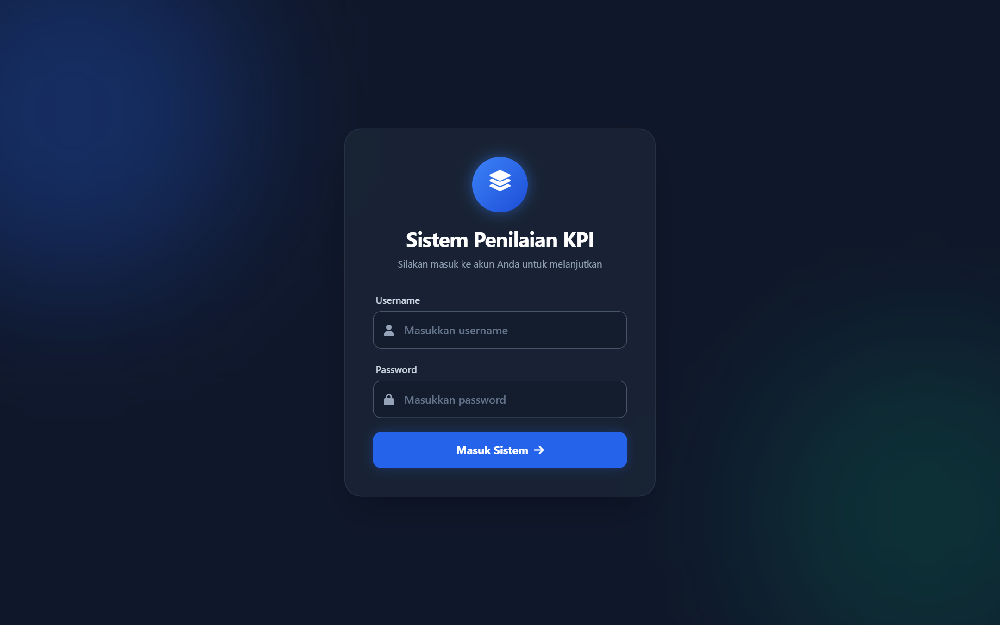
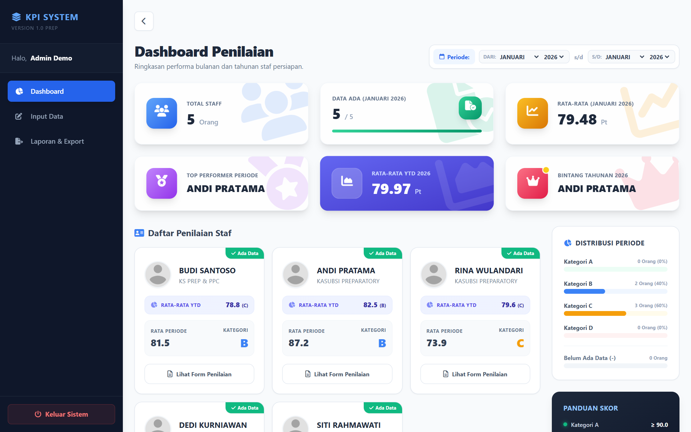
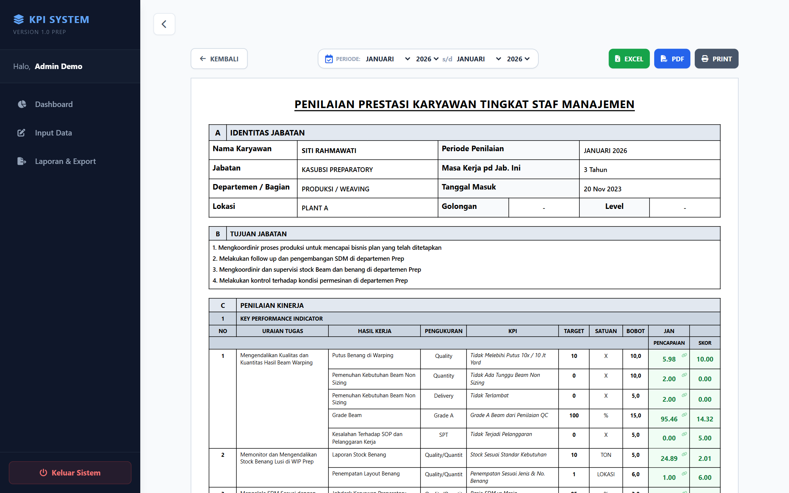
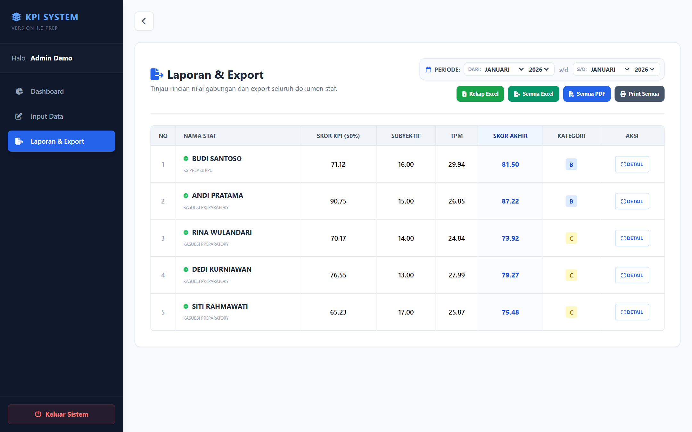

# Sistem Penilaian KPI Staff

Web app berbasis **Google Apps Script + React** untuk menilai KPI bulanan staf departemen produksi. Nilai KPI terisi otomatis dari data mentah, ditambah penilaian subyektif dan TPM, lalu hasilnya bisa dicetak sebagai PDF atau diekspor ke Excel.

> Versi portofolio. Nama staf, lokasi, dan data diganti dengan data dummy. Item dan bobot KPI hanya contoh.

**Demo online:** https://yudarynto.github.io/sistem-penilaian-kpi/demo/

## Masalah

Penilaian KPI bulanan disusun manual di Excel untuk setiap staf: angka disalin dari berbagai laporan, skor dihitung satu per satu, lalu format formulir dirapikan sebelum dicetak. Prosesnya lama dan rawan salah hitung.

## Solusi

- **Data mentah bulanan** (putus benang, stok WIP, waste, kehadiran, OEE, dan lainnya) diinput sekali di sheet `Data_Mentah_Warping`.
- Aplikasi **mengisi otomatis** nilai pencapaian dan skor KPI sesuai tipe KPI staf (Tipe 1 untuk kepala seksi, Tipe 2 untuk kasubsi).
- Skor KPI, subyektif, dan TPM dijumlahkan menjadi **Grand Total dan kategori penilaian**.
- Hasil akhir tersimpan di `Penilaian_Bulanan`.

## Fitur utama

- Login berbasis peran (**admin** bisa input dan simpan, **viewer** hanya melihat), dengan akun disimpan di sheet `Akun_User`.
- Pemilihan periode dalam bentuk rentang bulan.
- Formulir penilaian siap cetak, dengan ekspor ke **PDF** (html2pdf) dan **Excel** (ExcelJS).
- Data per staf, bulan, dan tahun otomatis diperbarui jika sudah ada (upsert), sehingga tidak tercatat dobel.

## Teknologi

Google Apps Script · React 18 (CDN + Babel) · Tailwind CSS · Google Sheets sebagai database · html2pdf.js · ExcelJS · FileSaver.js

## Struktur

```
src/
  Code.gs          backend: ambil data, simpan data mentah, simpan penilaian, verifikasi login
  Index.html       frontend React (single page)
  appsscript.json  konfigurasi web app
Template_Database_KPI (dummy).xlsx   template sheet beserta data dummy
```

## Cara menjalankan

1. Upload `Template_Database_KPI (dummy).xlsx` ke Google Drive, lalu buka dengan Google Sheets.
2. Buka **Extensions → Apps Script**, lalu salin `Code.gs` dan `Index.html`.
3. **Deploy → Web app**. Login demo: `admin` / `demo123`.

## Catatan keamanan

Password demo tersimpan sebagai teks biasa di sheet. Untuk produksi, gunakan hash (misalnya `Utilities.computeDigest`) atau login dengan akun Google (`Session.getActiveUser()`).

## Dampak

<!-- Isi dengan angka nyata -->
- Waktu menyusun penilaian KPI: **… jam → … menit per staf**
- Dipakai untuk **… staf** setiap bulan

## Screenshot & demo

Demo ada di folder `demo/` (login `admin` / `demo123`).

| Login | Dashboard | Formulir Penilaian | Laporan & Export |
|---|---|---|---|
|  |  |  |  |
